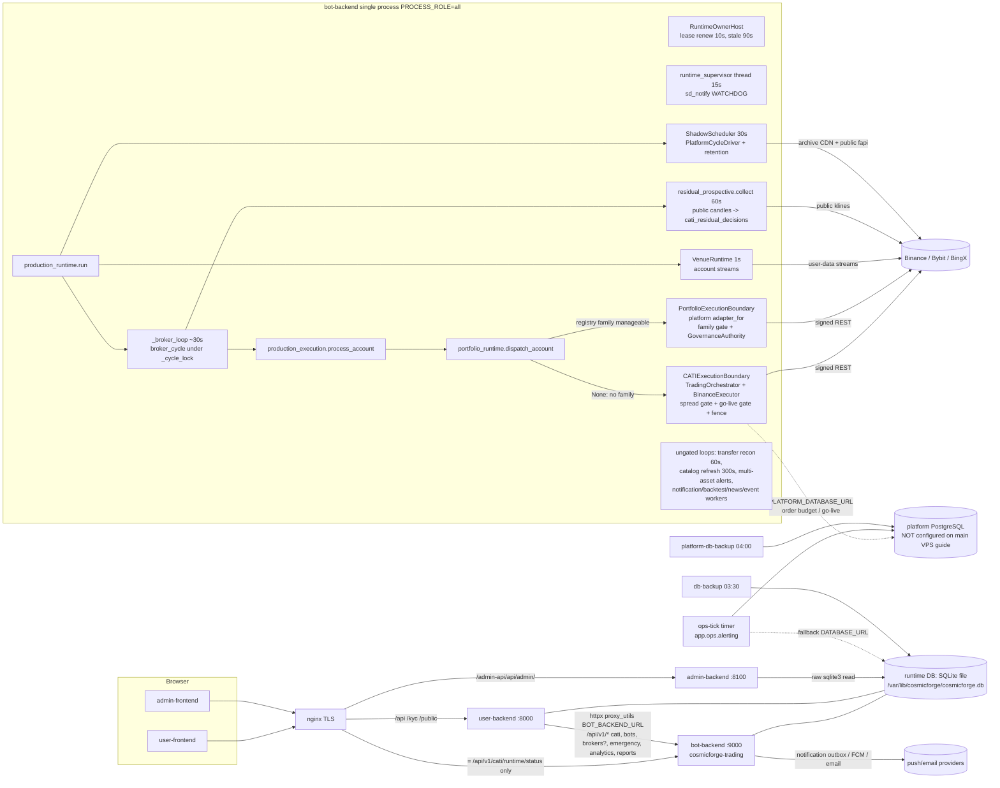

# Service Dependency Map

**Audit:** CosmicForge Tradingbot master end-to-end audit (read-only) · 2026-11-13 · baseline `origin/main` `649080b`
Companion to [TRADINGBOT_SYSTEM_INVENTORY.md](TRADINGBOT_SYSTEM_INVENTORY.md) and [TRADINGBOT_TRADING_EXECUTION_AUDIT.md](TRADINGBOT_TRADING_EXECUTION_AUDIT.md).
All edges below were traced from production entry points in source (L5); none has been observed on a production host.

## 1. Deployment topology and service-to-service communication

#### 2.2 Architecture / dependency map



Flows (L5):
* **Market data → decision**: `residual_prospective.collect` (owner-only, 60 s thread; `residual_prospective.py:373-438`)
  fetches public candles and commits hourly decisions into `cati_residual_decisions`;
  `ShadowScheduler` runs `PlatformCycleDriver` (daily-trend family, model + connected accounts, SHADOW_ONLY) and
  retention; FX watcher; `discovery_refresh_loop` refreshes instrument catalogs; `VenueRuntime` keeps account streams.
* **Decision → order**: `broker_cycle` → `sync` → `_sync_accounts` (`production_runtime.py:413-500`) per account:
  `sync_account` reads balance/positions/orders, reconciles positions, then `process_account`
  (`production_execution.py:575-615`) → `portfolio_runtime.dispatch_account` (portfolio tail, `PortfolioExecutionBoundary`)
  or, when it returns None (no manageable family and no intent history — currently every account at M0 per
  `SECTION_I_REMOVAL_INVENTORY.md:270-283`), `_process_account` with the residual decision → `CATIExecutionBoundary`.
* **Notification flow**: `user_events` outbox + legacy `notification_jobs` → `NotificationWorker` (5 s poll) in the
  trading process; ops alerts → ops-tick (platform DB) → sinks; crash alerts via `cosmicforge-alert@`.
* **Admin actions**: admin-frontend → nginx → user-backend `admin_*` routers → (emergency/governance/market-policy)
  httpx to bot-backend `/api/v1/admin/...` (`user-backend/app/api/admin_emergency.py:210`) → `production_runtime.flatten`
  under `_cycle_lock` + `PreemptionGate`. Read-only admin reports via admin-backend direct SQLite reads.
* **DB ownership**: one runtime SQLite file shared by bot-, user- and admin-backend (`docs/VPS_TRADING_DEPLOYMENT.md:719`,
  `docs/INSTALL_SINGLE_SERVER.md:113-121`); bot-backend and user-backend both run `migrate()` at import; admin-backend
  never migrates. Platform PostgreSQL (`PLATFORM_DATABASE_URL`) holds order budget, durable jobs/intents, worker
  assignments, L-08 policies, go-live records, alerting — absent from the main VPS guide (2.6).

## 2. Trading runtime call graph (production)

#### 2.1 Production entry point and what actually runs (call graph)

```
cosmicforge-trading.service  ExecStart uvicorn app.main:app --workers 1
 app/main.py:680  _startup_run_manager -> runner_loop()  (main.py:1117)
    production: RuntimeOwnerHost (integration/runtime_owner.py) -> RuntimeOwnerLoop.run (runtime_owner_loop.py:136)
    = lease acquire/renew + watchdog only, tick does nothing (runtime_owner.py:41-68).  MultiBotRunner/PaperRunner NOT built.
 app/main.py:981  _startup_background_jobs -> _when_owner() (waits for lease, main.py:962)
    settings.production -> asyncio.create_task(production_runtime.run(DB()))      (main.py:1000-1001)
    else               -> residual_simulation.run
 integration/production_runtime.py:809 run(db)
    ShadowScheduler(db).run(interval=30)          platform_runtime.py:28-106  -> PlatformCycleDriver.run_due (SHADOW ONLY)
    VenueRuntime(...).run()                        (venue reads)
    _broker_loop(db)  production_runtime.py:884, every 30 s:
       residual_prospective.schedule (60 s throttle, 1 thread)     -> collect() (residual_prospective.py:373)
       forward_observe.schedule                                     (public BTC/ETH book observations)
       broker_cycle -> sync -> _sync_accounts -> sync_account -> _sync_with_client  (production_runtime.py:413/451/244/276)
           -> production_execution.process_account (production_execution.py:575)
                -> portfolio_runtime.dispatch_account (portfolio_runtime.py:410)  [families with DEMO/LIVE in allowed_modes]
                   else -> _process_account (production_execution.py:978)          [frozen RESIDUAL TradePlan path]
```

Two, and only two, decision sources can reach an order in production:

| Path | Family | Signal producer | Executor |
|---|---|---|---|
| A. TradePlan path | `RESIDUAL_MOMENTUM_PORTFOLIO_TOP1` (H-015) | `residual_prospective.collect` hourly, table `cati_residual_decisions` | `_process_account` -> `CATIExecutionBoundary.process_trade_plan` (`execution/boundary.py`) |
| B. Portfolio path | any registry family with a `pipeline_adapter` AND DEMO/LIVE in `allowed_modes` -> today only `DAILY_TREND` (H-018) qualifies by construction | `pipeline/daily_trend.py` `broker_account` | `portfolio_runtime.ConnectedPortfolioRuntime.process` -> `pipeline/execution.PortfolioExecutionBoundary.execute` |

## 3. Decision → order → protection transitions

#### 2.3 End-to-end transitions (item 2)

| # | Transition | Source (file:line) | In/out schema | DB writes | Error conditions | Tests (L4) | Production wiring | Gap |
|---|---|---|---|---|---|---|---|---|
| 1 | Market data -> validation | residual_prospective.py:373-424 `collect`, :49 `hourly_window`; daily_feed via platform_runtime.py:14 | raw kline rows -> numpy window | cati_residual_inputs, cati_residual_tracker heartbeat | RateLimited (5-min backoff), INPUT_GAP_OR_DUPLICATE, INVALID_OHLCV; missed hour -> MISSED_PROSPECTIVE_BOUNDARY | test_production_execution, test_natural_signal_replay | _broker_loop :893 -> residual_schedule | PublicCandles bypasses http budget; no per-symbol timeout budget for the 15-min window |
| 2 | Features -> regime | none in production | -- | -- | -- | regime tests (unit) | **not wired** | CATI-01 |
| 3 | Strategy evaluation -> opportunity | `decision_snapshot` / `Tracker.commit_decision` residual_prospective.py:180; daily trend `pipeline.broker_account` portfolio_runtime.py:353 | snapshot dict -> decision row; DAILY_TREND -> `IntentBatch` (pipeline/contracts) | cati_residual_decisions; cati_family_decisions (record_decision) | PROSPECTIVE_HOUR_BOUNDARY_REQUIRED, FAMILY_BROKER_DECISION_STALE | test_step3_connected_portfolio | residual: yes; daily trend broker stage: only if DEMO in allowed_modes (never today) | -- |
| 4 | Opportunity -> ranking/portfolio decision | `eligibility` production_execution.py:124; reservation `boundary.reservations.reserve` :1121 | row -> eligibility code; `TradePlan` (contracts/trade_plan) via `build_plan` :431 | cati_trade_plans, reservation store | RESIDUAL_DECISION_NOT_QUALIFIED, PROSPECTIVE_ENTRY_WINDOW_EXPIRED, CATI_DECISION_ALREADY_ATTEMPTED | test_production_final_audit, natural replay | yes | lineage placeholders (CATI-07) |
| 5 | Bot configuration | `boundary_for` production_execution.py:478; portfolio_runtime.py:69 | BotInstance -> EffectiveBotPolicy | -- | PRODUCTION_REQUIRES_CATI_BOT, PRODUCTION_REJECTS_PAPER_BOT, ACCOUNT_EXECUTION_OWNER_AMBIGUOUS | test_bot_sizing_config (15) | yes | fixed amount = margin semantics (CATI-06) |
| 6 | Sizing -> risk | `prepare_submission` :1204, `account_risk` :255, `persisted_risk_controls` :400 | plan + equity -> sizing evidence | cati_production_daily_risk, cati_account_period_risk | EXECUTABLE_PRICE_RISK_EXCEEDED, ACCOUNT_DAILY_LOSS_LIMIT_REACHED, kill switch, drawdown | test_k1_sizing_gates, test_risk_based_sizing | yes | -- |
| 7 | Execution eligibility (family + venue + L-08) | provenance.py:256-365 `FamilyExecutionGate`; boundary.py:917-958 `_reserve_spread`; experimental_demo.py:372 `plan_scope` | plan -> (allowed, reason) | cati_experimental_demo_events (ENTRY_CLAIMED) | FAMILY_FAILED_RESEARCH, FAMILY_STAGE_NO_ORDER_AUTHORITY, VENUE_ADAPTER_NOT_CERTIFIED, PLATFORM_ORDER_BUDGET_UNAVAILABLE, MARKET_FALLBACK_DISABLED_BY_POLICY, MARKET_SPREAD_EXCESSIVE, EXPERIMENTAL_DEMO_NOTIONAL_LIMIT_EXCEEDED | test_experimental_demo (20), test_step5_spread_boundary | path A only | path B has no spread/L-08 gate (CATI-04) |
| 8 | Broker order -> fill | boundary.process_trade_plan; pipeline/execution.py:1043 `place_order` | EntryRequest/OrderRequest -> attempt / intent rows | attempt store, cati_production_fills, cati_execution_intents/_events | SUBMIT_UNKNOWN_PENDING_RECONCILIATION, DEMO_ORDER_SUBMISSION_DISABLED | natural replay (mocked transport) | yes | no venue evidence of a strategy order (CATI-02) |
| 9 | Protection | reconcile_executions :1331 (protection at ~:1470), production_protection.place_native_protection | position -> closePosition STOP/TP | cati_production_protection | PROTECTION_STATE_UNKNOWN, fail-safe close on ABSENT | test_production_position_safety | yes | order switch off strands path-A protection even on branch (CATI-05) |
| 10 | Monitoring/exit | maintain_account :683, horizon close (48 h) in reconcile_executions; path B stop replacement | -- | cati_production_closes | -- | position safety tests | yes | `position/` exit engine unused (by design) |
| 11 | Reconciliation | production_runtime.py:298-314 `reconcile_position_rows`; reconcile_confirmed_intents | broker positions -> projections | position projections, cati_production_state, account_equity_snapshots | ACCOUNT_OWNER_MAPPING_REQUIRED, READ_FAILED | test_production_loop | yes | -- |

## 4. Restart, takeover and duplicate-order analysis

#### 2.6 Restart / takeover / duplicate-order analysis

* **Single systemd process (documented topology)**: a successor cannot start until the old process exited (same unit),
  so overlap is impossible; crash between claim and send → orphan `PENDING_SUBMIT` → reconcile by client id → no
  resubmission (L5 + L4). Deterministic plan-derived client id means a re-run of the same plan maps to the same id.
  **Duplicate orders from restart: not found (L5/L4).**
* **Graceful stop** (`runtime_shutdown._quiesce_inner` 167-240): stop entries → stop scheduler → wait sim cycle 15 s →
  `production_runtime.wait_idle(30 s)` → **release lease even if the broker cycle is still running** → close session.
  Then `_shutdown_run_manager` spawns `force_exit` which, because `asyncio.get_event_loop()` raises in a non-main
  thread on Python 3.12 (verified), **always calls `os._exit(0)` 1.5 s later** (`main.py:770-788`), skipping the
  remaining shutdown hooks (`_shutdown_notifications`, `_shutdown_cati_simulation` → `run()` finally/drain,
  `_shutdown_signal_scheduler`, `on_shutdown`). A broker cycle that needs >30 s (many accounts, slow venue) can be
  cut between fill and protection placement; recovery happens on the next start (≥ RestartSec 10 s + startup + lease)
  — a naked-position window, not a duplicate (ARCH-09).
* **Multi-process / container topologies** (staging `bot-trading-assigned`, scaled profiles): cross-host takeover is
  heartbeat-based (90 s). A frozen-then-resumed old holder re-checks `owner_current` per account and `entry_refusal`
  right before submit, but there is no fencing token on the runtime lease itself, so a TOCTOU window between the last
  check and `adapter.submit_entry` exists (L7); assigned-mode account fences have TTL + margin
  (`config_profiles.py` LEASE rule). The attempt claim is per-DB unique so two processes on the **same** runtime DB
  cannot both CREATE the same plan. Multi-worker mode is OFF by default and owner-gated (compose :105-115).
* **Order switch off** (main): per branch commit 334f2ff message, with `DEMO_/LIVE_ORDER_SUBMISSION_ENABLED=false`
  protective stops, reduce-only exits and emergency flatten were refused at the transport — a restart/stop under the
  switch strands open positions (FIXED_ON_BRANCH_ONLY; EXEC area owns verification).

## 5. Systems present in the repository but not reached from any production entry point

| Component | Location | Only callers | Disposition |
|---|---|---|---|
| Regime, forecast, ranking, veto, controller, market_state engine, position exit engine, cycle_shadow, shadow_hook, cati_dispatch | `app/trading_intelligence/{regime,forecast,ranking,veto,controller,market_state,position}`, `integration/{cycle_shadow,shadow_hook,cati_dispatch}.py` | `app/runner/runner.py` (PaperRunner, non-production) and `research/certification` | Intelligence stack is not in the production decision path (CATI-01) |
| 4 x 15m setup specialists | `app/trading_intelligence/setups` | research diagnostics | No pipeline adapter, never evaluated (RES inventory) |
| Legacy strategies (Master/Robust Ensemble, Donchian, Bollinger, VWAP, Supertrend, Squeeze, SMA Cross, V2 Trend Pullback, Hold Breakdown) and IOFS gate | `app/strategy/*`, IOFS modules | scripts/validation; `strategy/registry.py:47-58` always returns the CATI binding | Dead for trading; IOFS mode still surfaced in /health (RES-16) |
| PaperRunner / MultiBotRunner / residual_simulation | `app/runner/*`, `integration/residual_simulation.py` | non-production branch of `main.py` | `get_runner()` returns 410 in production |
| Standalone TradingWorker, durable job runner | `app/platform_workers/worker.py`, `runtime_jobs.py` | drills; job runner only when `PLATFORM_DATABASE_URL` is set | ARCH-14 |
| DailySnapshotScheduler | `app/analytics/daily_snapshot_scheduler.py` | none | ARCH-10 |
| ML drift report, nightly dataset builder / retrain | `app/ml/monitoring.py`, `app/jobs/nightly_dataset_builder.py` | manual scripts | RES-09 |
| venue_history (BingX/Bybit history), TradFi markets/calendars, universe engine, MT bridge, OANDA, IBKR | `app/market_data/venue_history.py`, `app/markets`, `app/universe`, `backends/mt-bridge` | research scripts / legacy runner | DATA-13 |
| user-backend SQL migrations | `backends/user-backend/migrations/*.sql` | manual `run_migration.py` | ARCH-12 |
| admin-backend (64 routes) | `backends/admin-backend` | admin-frontend only when a `VITE_USE_ADMIN_BACKEND_*` flag is set | LEAD-03 / ARCH-06 |
