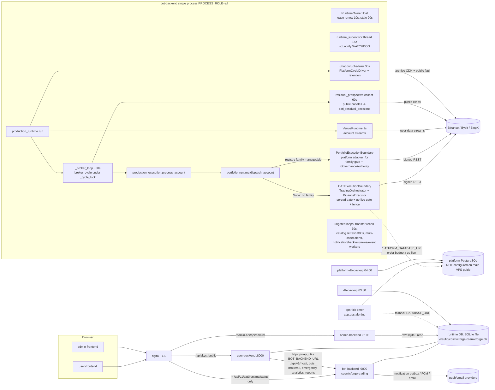

# System Inventory: Services, Entry Points, Workers, Duplicates, Persistence (Sections 4, 20, 21)

**Audit:** CosmicForge Tradingbot master end-to-end audit (read-only) · **Date:** 2026-11-13
**Baseline:** `origin/main` = `649080b` · engineering branch `origin/ccr-b5c520cf-80g8x2` = `732e0e2` (7 commits not on main, inspected by diff/worktree only)
**Master report:** [TRADINGBOT_MASTER_END_TO_END_AUDIT.md](TRADINGBOT_MASTER_END_TO_END_AUDIT.md) · **Gap register:** [TRADINGBOT_MASTER_GAP_REGISTER.csv](TRADINGBOT_MASTER_GAP_REGISTER.csv)

Evidence levels used throughout: L1 observed authenticated behaviour · L2 real venue evidence · L3 integration test with real boundaries ·
L4 contract/unit test with mocks · L5 static source inspection · L6 documentation/historical claim · L7 inference.
No production database, VPS or authenticated venue session was available to this audit; nothing below is L1.
Finding IDs are stable and map to the gap register (column "Master ID" consolidates duplicates across areas).

## Lead auditor summary
| Item | Count / fact | Evidence |
|---|---|---|
| Backends | bot-backend (trading runtime + CATI, ~180k Python lines, 693 files), user-backend (portal/admin API, ~25k lines), admin-backend (read-only reporting, ~5k lines), shared_lib (~38k lines) | `find`/`wc` this audit |
| Frontends | user-frontend (138 TS/TSX files), admin-frontend (120 files); both call user-backend; admin-frontend optionally calls admin-backend per `VITE_USE_ADMIN_BACKEND_*` flag | `src/api/client.ts` |
| HTTP routes | 709 (user 368, bot 277, admin 64) | TRADINGBOT_API_INVENTORY.csv |
| systemd units | 3 services + 6 timers/services (ops-tick, deadman, healthcheck, db-backup, platform-db-backup, offsite-backup) + alert template | `deploy/systemd/` |
| Backend tests | bot 8,000+ (CI), user ~903 passed, admin 98, shared 299, root 7 (this audit) | see master report §L |
| Strategy families registered | 6 (all M0, none certified) | STRATEGY_RESEARCH_AUDIT |
| Venues with production adapters | Binance, Bybit, BingX (only Binance DEMO genuinely certified) | TRADING_EXECUTION_AUDIT |

The service dependency diagram and data/decision/order flows are in [TRADINGBOT_SERVICE_DEPENDENCY_MAP.md](TRADINGBOT_SERVICE_DEPENDENCY_MAP.md).

---
## ARCH — Architecture, workers, duplicates, persistence, restart safety

Auditor area: ARCH (audit sections 4, 20, 21 + duplicate-functionality analysis). Repo `origin/main` = 649080b.
Branch `origin/ccr-b5c520cf-80g8x2` inspected with `git show` / `git diff` only.

### 1. Scope and method

* Read every production entry point: `deploy/systemd/*` (ExecStart → module), `backends/*/app/main.py`
  (routers, startup/shutdown hooks, tasks), `deploy/containers/*`, `deploy/staging/docker-compose.staging.yml`,
  `deploy/nginx/cosmicforge-app.conf`, CLI `__main__` modules.
* Traced the trading runtime from `app.main` startup hooks → `production_runtime.run` → broker cycle →
  `production_execution` / `portfolio_runtime` → the two execution boundaries; traced lease/ownership,
  shutdown (`runtime_shutdown.quiesce`), supervisor, platform-worker layer.
* Grep-traced callers for each candidate duplicate / unstarted worker (non-test importers).
* Treated `docs/implementation/LEGACY_RUNTIME_DISPOSITION.md`, `SECTION_I_REMOVAL_INVENTORY.md`,
  `QUARANTINE_REGISTER.md` as claims and checked them against code.
* Targeted tests run (venv py3.12, TEST env, SQLite):
  * `tests/test_runtime_owner_readers.py tests/test_runtime_ownership_cross_host.py tests/test_runtime_owner_loop.py
    tests/trading_intelligence/test_section20_execution_boundary.py tests/trading_intelligence/test_production_loop.py
    tests/trading_intelligence/test_step5_broker_cycle_assignment.py` → **119 passed, 21 skipped** (skips: need
    `PLATFORM_TEST_POSTGRES_URL`).
  * `tests/trading_intelligence/test_step5_spread_boundary.py` → **25 passed, 20 skipped** (PG-only skipped);
    `::test_production_without_a_platform_database_refuses_every_entry` **passed** (L4).
  * Python 3.12 behaviour check of `asyncio.get_event_loop()` from a non-main thread → raises `RuntimeError` (used in
    finding ARCH-09).

### 2. Detailed analysis

#### 2.1 Service and entry-point inventory (L5)

| Entry point | Command / module | Port / trigger | Role |
|---|---|---|---|
| `cosmicforge-trading.service` | `uvicorn app.main:app --workers 1` in `backends/bot-backend`, `Type=notify`, `WatchdogSec=180`, `Restart=always`, `TimeoutStopSec=120` | 127.0.0.1:9000 | The single CATI trading runtime (+ bot-backend HTTP). Config from `backends/bot-backend/.env` |
| `cosmicforge-user-backend.service` | `uvicorn app.main:app` in `backends/user-backend` | 127.0.0.1:8000 | Portal/admin API; proxies to bot-backend |
| `cosmicforge-admin-backend.service` | `uvicorn app.main:app` in `backends/admin-backend` | 127.0.0.1:8100 | Read-only admin reporting, raw `sqlite3` reads |
| `cosmicforge-ops-tick.{service,timer}` | `python -m app.ops.alerting --dotenv … --alerts-env … --backup-dir …` | every minute | Ops alert engine (platform DB `Database.from_env`) |
| `cosmicforge-ops-deadman.{service,timer}` | `python -m app.ops.alerting --check-tick --max-tick-age 300` | every 5 min | Dead-man check on ops tick |
| `cosmicforge-healthcheck.{service,timer}` | `scripts/vps_health_check.py --url http://127.0.0.1:9000` | every 2 min | Health probe → alert unit |
| `cosmicforge-db-backup.{service,timer}` | `scripts/backup_trading_db.py --keep 7 --compress` (SQLite online backup API + `quick_check`) | 03:30 UTC | Runtime SQLite backup |
| `cosmicforge-platform-db-backup.{service,timer}` | `scripts/backup_platform_db.py` (`pg_dump -Fc`) | 04:00 UTC | Platform PG backup |
| `cosmicforge-offsite-backup.{service,timer}` | `scripts/offsite_backup.py` | 04:30 UTC | Encrypted upload |
| `cosmicforge-alert@.service` | `scripts/notify_failure.py %i --cooldown 900` | OnFailure/ExecStopPost | Crash alert |
| Staging compose | `postgres`, `migrate` (`python -m shared_lib.persistence.sql migrate`), `bot-trading` (PROCESS_ROLE=trading), `bot-api` ×2 (api), optional `bot-trading-assigned` (profile multi-worker), user/admin backends, frontends, `healthcheck` loop, `ops-tick --loop` | — | Staging only; runtime DB is still SQLite on a volume (`docker-compose.staging.yml:76,99,123,142,150,181`) |
| CLI `__main__` | `app.ops.alerting`, `shared_lib.persistence.sql` (migrate/status), `app.trading_intelligence.pipeline.__main__`, research CLIs (`research/costs`, `evaluator`, `governance`, `certification/cli.py`), `market_data.daily_feed/daily_dataset`, `golive/drills.py`, `platform_workers/drill.py`, `scale/measure_fanout.py` | manual | Operator / research tools; none started by systemd except `app.ops.alerting` |

nginx (`deploy/nginx/cosmicforge-app.conf:145-318`): browser traffic goes to user-backend (8000) and admin-backend
(8100, `/admin-api/api/admin/`); the only direct route to the trading backend is `= /api/v1/cati/runtime/status`
(line 174-176).

**bot-backend startup hooks** (`backends/bot-backend/app/main.py`, run in order by `_lifespan` 349-355):
1. import time: `runtime_preflight.enforce` (111-112), `migrate(db_path)` (194), module-level construction of
   `NotificationDispatcher`, `NotificationWorker`, `BacktestWorker`, calendar/event/news workers (856-896).
2. `_startup_open_runtime_session` (576), `_startup_validate_config` (582, safety check; live mode fails closed),
   `_startup_stop_file_watcher` (614, 1 s poll task), `_startup_runtime_supervisor` (664, thread, 15 s interval,
   `WATCHDOG=1`, exit 70 on fault — `ops/runtime_supervisor.py:50-64,479-482`).
3. `_startup_run_manager` (680-718): `runner_loop()` task → production: `RuntimeOwnerHost` lease loop only (1115-1151);
   plus **ungated by lease** `transfers.reconciliation_loop` (60 s), `activation.account_status.discovery_refresh_loop`
   (300 s), `ops.multi_asset_alerts.multi_asset_alert_loop`.
4. `_startup_notifications` (899-911): NotificationWorker, BacktestWorker, event ingestion, calendar sync, event
   reaction, news ingestion, real-time news — started in every trading-role process, **not lease-gated**.
5. `_startup_background_jobs` (981-1007): waits ≤90 s for lease ownership, then
   `production_runtime.run(DB())` (production) or `residual_simulation.run` (non-production), then APScheduler with
   `signal_expiry` every 5 min (production registers nothing else, 1021-1062).

**`production_runtime.run`** (`app/trading_intelligence/integration/production_runtime.py:809-845`): configures
`broker_assignment` layer (None unless `PLATFORM_DATABASE_URL`), starts `ShadowScheduler` (30 s, `platform_runtime.py`)
and `VenueRuntime` (1 s, account streams, `venue_runtime.py`), then `_broker_loop` (884-917, ~30 s): owner-only
singletons `residual_prospective.schedule` (60 s collector thread), `forward_observe.schedule`, FX watcher (60 s);
`broker_cycle` on a worker thread under `_cycle_lock`; durable `_run_jobs` only when the layer is enforced.

user-backend (`backends/user-backend/app/main.py`): runs `migrate()` at import (24-32), `bootstrap_admin`, ~45 routers;
no background tasks except a per-request email thread (`api/auth.py:384`). admin-backend (`app/main.py`): 10 read
routers, `AdminDB` raw sqlite3 (`app/persistence/db.py`), no service calls (only reports `BOT_BACKEND_URL` in
`/health`, `api/health.py:35-36`).

#### 2.2 Architecture / dependency map

Flows (L5):
* **Market data → decision**: `residual_prospective.collect` (owner-only, 60 s thread; `residual_prospective.py:373-438`)
  fetches public candles and commits hourly decisions into `cati_residual_decisions`;
  `ShadowScheduler` runs `PlatformCycleDriver` (daily-trend family, model + connected accounts, SHADOW_ONLY) and
  retention; FX watcher; `discovery_refresh_loop` refreshes instrument catalogs; `VenueRuntime` keeps account streams.
* **Decision → order**: `broker_cycle` → `sync` → `_sync_accounts` (`production_runtime.py:413-500`) per account:
  `sync_account` reads balance/positions/orders, reconciles positions, then `process_account`
  (`production_execution.py:575-615`) → `portfolio_runtime.dispatch_account` (portfolio tail, `PortfolioExecutionBoundary`)
  or, when it returns None (no manageable family and no intent history — currently every account at M0 per
  `SECTION_I_REMOVAL_INVENTORY.md:270-283`), `_process_account` with the residual decision → `CATIExecutionBoundary`.
* **Notification flow**: `user_events` outbox + legacy `notification_jobs` → `NotificationWorker` (5 s poll) in the
  trading process; ops alerts → ops-tick (platform DB) → sinks; crash alerts via `cosmicforge-alert@`.
* **Admin actions**: admin-frontend → nginx → user-backend `admin_*` routers → (emergency/governance/market-policy)
  httpx to bot-backend `/api/v1/admin/...` (`user-backend/app/api/admin_emergency.py:210`) → `production_runtime.flatten`
  under `_cycle_lock` + `PreemptionGate`. Read-only admin reports via admin-backend direct SQLite reads.
* **DB ownership**: one runtime SQLite file shared by bot-, user- and admin-backend (`docs/VPS_TRADING_DEPLOYMENT.md:719`,
  `docs/INSTALL_SINGLE_SERVER.md:113-121`); bot-backend and user-backend both run `migrate()` at import; admin-backend
  never migrates. Platform PostgreSQL (`PLATFORM_DATABASE_URL`) holds order budget, durable jobs/intents, worker
  assignments, L-08 policies, go-live records, alerting — absent from the main VPS guide (2.6).

#### 2.3 Workers / schedulers

| Worker | Trigger / frequency | Started by prod entry? | Ownership | Failure / retry | Health reporting |
|---|---|---|---|---|---|
| RuntimeOwnerHost lease loop | asyncio task, renew 10 s, stale 90 s (`runtime_ownership.py:34-37`) | yes (`main.py:692`) | is the lease | renew failure → loop stops; supervisor exits 70 | `/health` `runtime_owns_lease`, supervisor |
| Runtime supervisor | thread 15 s | yes (`main.py:664-676`) | n/a | exit 70 → systemd restart; `WatchdogSec=180` | sd_notify READY/WATCHDOG |
| CATI broker cycle | ~30 s loop, worker thread | yes (lease-gated, `main.py:981-1007`) | `owner_current` per account + `entry_refusal`; assigned-mode fences if platform DB | per-account isolated; `_progress.last_error` | supervisor CYCLE_STALLED, `/health` |
| Residual collector | 60 s thread pool, 240 s backoff on rate limit | yes, owner-only | owner_current inside loop | logged, retried | heartbeat row; supervisor COLLECTION_STALLED |
| ShadowScheduler / retention | 30 s; retention daily | yes, owner-only | `owns_runtime` | logged; retried next tick | logs |
| VenueRuntime streams | 1 s; discovery 30 s | yes, owner-only | `owns_runtime` | per-session isolated | stream health gates entries (`user_stream.stream_allows_entries`) |
| Forward observe / FX watcher | each cycle / 60 s | yes, owner-only | owner | `_isolated` | logs |
| Transfer reconciliation | 60 s | yes, **not lease-gated** | none (read-only broker history) | logged | none |
| Catalog refresh | 300 s | yes, not lease-gated | none | logged | none |
| Multi-asset alerts | loop | yes, not lease-gated | de-dup in alert store | logged | alert store |
| NotificationWorker | 5 s / 0.5 s | yes (trading role), not lease-gated | claim token UPDATE | retry/backoff/dead; **no stale `processing` reclaim** | none |
| BacktestWorker | poll | yes, not lease-gated | claim token | **no stale `processing` reclaim** | none |
| Event ingestion / calendar sync / event reaction / news / real-time news | loops | yes, not lease-gated (shadow mode) | none | logged | none |
| APScheduler `signal_expiry` | 5 min | yes, owner-only | owner | APScheduler | logs |
| Durable job runner (ORDER/RECONCILIATION/NOTIFICATION/SHADOW_COMPARISON/OPERATIONAL_RETRY, `platform_workers/runtime_jobs.py`) | after each cycle | **only if `PLATFORM_DATABASE_URL` + layer enforced** (`production_runtime.py:906-908`, `broker_assignment.py:333-348`) | assignment fences, job leases | at-least-once + idempotency keys | ops-tick evaluators |
| Standalone `TradingWorker` (`platform_workers/worker.py`) | — | **no** (callers: `golive/drills.py`, `platform_workers/drill.py` only) | — | — | — |
| `DailySnapshotScheduler` (`analytics/daily_snapshot_scheduler.py`) | daily thread | **no caller anywhere** | — | — | — |
| `daily_paper_validation_monitor` | 23:30 cron | non-production only (`main.py:1064-1086`) | — | — | — |
| Nightly dataset / ML retrain (`app/jobs/nightly_dataset_builder.py`) | — | no (only `scripts/ml/retrain_pipeline.py`, manual) | — | — | — |
| ops-tick / deadman | 1 min / 5 min timers | units exist; **not enabled by `docs/VPS_TRADING_DEPLOYMENT.md`** on main or branch (only `docs/operations/ALERTING.md:220`) | `TickLease` | — | dead-man |
| platform-db-backup timer | 04:00 | **not enabled** by the VPS guide (branch adds a one-off `systemctl start` in upgrade step only, branch guide :450) | — | — | ops-tick backup evaluator (if running) |

#### 2.4 Duplicate implementations (authoritative vs legacy)

| Concern | Implementations | Authoritative in production (reached from entry) | Legacy / compat / unused |
|---|---|---|---|
| Trading orchestration | (a) `integration/production_runtime` + `production_execution` + `portfolio_runtime`; (b) `app/runner/runner.PaperRunner` + `multi_runner.MultiBotRunner`; (c) `integration/cycle_shadow` + `cati_dispatch`; (d) `integration/residual_simulation`; (e) `platform_workers/worker.TradingWorker` | (a) only (`main.py:999-1001`) | (b),(c),(d) non-production only (`main.py:1126-1137`, `get_runner()` 410 in production `main.py:791-793`); (e) drills only. **Verified** `LEGACY_RUNTIME_DISPOSITION.md` E-05 claim. `SECTION_I_REMOVAL_INVENTORY.md:11-25,334-340` still says `multi_runner` is built in production — **stale**, superseded by E-05. |
| Execution boundary / order execution | `trading_intelligence/execution/boundary.CATIExecutionBoundary` (+ legacy `app/core/trading_orchestrator.TradingOrchestrator` risk + `app/execution/executor.BinanceExecutor` 3,863 lines) vs `pipeline/execution.PortfolioExecutionBoundary` (platform adapter) vs `cati_dispatch.boundary_for` | **both** CATI and Portfolio boundaries are live in production (`production_execution.py:478-572`, `portfolio_runtime.py:69-130`, dispatch rule 575-591) | `cati_dispatch.boundary_for` legacy-runner only. Note: legacy `TradingOrchestrator`/`BinanceExecutor`/`app.decision` are *transitively authoritative* via `CATIExecutionBoundary` — they are not dead. |
| Execution authorization | `AccountExecutionAuthority` + `account_fence.entry_refusal` + `PlatformSpreadGate` + `_go_live_reason` (CATI boundary, `boundary.py:383-393,889-905,917-955`) vs `FamilyExecutionGate` + `GovernanceAuthority` + stream health + adapter certification (Portfolio boundary, `pipeline/execution.py:512-650`) | both, **with different gate sets** — see ARCH-02 | — |
| Strategy selection | CATI families via `pipeline/family_registry.FamilyRegistry` and residual family `residual_prospective`; legacy `app/strategy/*` (24 importers incl. `master_ensemble`), `app/adaptive`, `app/decision`, `app/signals` | CATI registry + residual (production requires `strategy_id in ("cati", FAMILY)`, `production_execution.py:501-502`) | `app/strategy` registry still imported by `main.py:127` (API listing); `app/adaptive` only from `runner.py`; `app/signals` = Signal Center product surface (owner decision, Batch 10) |
| Position sizing / risk evaluation | `trading_intelligence/execution/risk_sizing`, `pipeline/portfolio.AccountLimits`, legacy `TradingOrchestrator.process_trade_plan` (+ `SystemLimits`/`UserConfigurableLimits`), executor slot/margin gates, `app/risk/*` daily loss + adaptive budget (`production_execution.account_risk` 255-398) | CATI boundary path: orchestrator + risk_sizing + executor gates (layered); Portfolio path: `AccountLimits` + `ReservationLedger` | `app/risk/position_sizer` has 0 importers |
| Market-data acquisition | `residual_prospective.PublicCandles`, `market_data/daily_feed` + `binance_archive` (shadow), `venue_runtime` streams, `exchange/platform_adapter/http_budget.public_get`, legacy `MarketDataSnapshotService` (event-reaction worker), `scripts/acquire_*` research | the first four | snapshot service is shadow-only; acquisition scripts are research |
| Broker-client construction | `shared_lib.broker.client_factory.build_client_from_auth` (production cycle), `platform_adapter.http_budget.build_budgeted_client` (VenueRuntime, account_client), `platform_adapter.factory.adapter_for` (portfolio boundary wraps the client), `.env`-key `BinanceFuturesClient(...)` in legacy `main.py` routes | first three | legacy routes: most return 410, but `/binance/leverage`, `/binance/cancel-all`, `/trade/protection`, `/binance/order`, `/binance/ping|price|klines` still act with `.env` keys (ARCH-08) |
| Portfolio accounting / account sync | `production_runtime.sync_account` + `production_portfolio` + `income_ledger` + `customer_dashboard` + `analytics/equity` (+ `equity_snapshots` written only on CLOSE fills, `shared_lib/persistence/trade_fills.py:435-445`), `app/risk/capital_ledger`; streams in `VenueRuntime`; `activation/account_status.refresh_if_stale` | `sync_account` is the single broker-truth reader per cycle | `DailySnapshotScheduler` never started (ARCH-10). DEMO/LIVE equity summing fixed on branch only (65372fe; PORTFOLIO area) |
| Bot lifecycle | bot-backend `core/bot_instance_service` + `api/bot_instances`; user-backend `bot_instances_proxy` proxies | bot-backend | no duplicate writer found |

#### 2.5 Persistence

* **Runtime DB** — `shared_lib/persistence/db.DB` (`db.py:95-330`): SQLite by default (WAL, `busy_timeout=10000`,
  `synchronous` from `SQLITE_SYNCHRONOUS`, FULL in `deploy/env.production.example`), or PostgreSQL through
  `legacy_postgres` (sqlite3-surface adapter, single global advisory write lock, `legacy_postgres.py:1-40`).
  Production refuses a missing `DATABASE_URL` (`db.py:148-152`). Schema is **unversioned**: `migrate()` (2,862 lines of
  idempotent `CREATE ... IF NOT EXISTS`/column adds), `production_schema.ensure`, first-use creators
  (`legacy_first_use.py`), lease schema. Platform PG has a **versioned, checksummed** migrator
  (`shared_lib/persistence/sql/migrations.py`; branch guide says versions 1–61).
* **user-backend SQL migrations** (`backends/user-backend/migrations/*.sql`, `run_migration.py`): not run by any
  entry point or install guide; two files share number `003_`; re-running 004 rebuilds `mt_pairing_sessions` and drops
  later columns (`legacy_first_use.py:148-160` documents this). MT pairing table therefore only exists if an operator
  ran the script (ARCH-12).
* **Order idempotency** (CATI boundary): attempt id = hash(trade_plan_id, plan hash, account); deterministic
  `clientOrderId` from plan identity, no time bucket (`execution/executor.py:623-651`); durable `PENDING_SUBMIT` claim
  by unique `record_id` insert **before** the venue call (`boundary.py:407-438`, `evidence/stores.py:158-167`);
  `SUBMIT_UNKNOWN` on exceptions, reconciled by `query_order(client_order_id)` and never re-submitted
  (`boundary.py:575-610,765-800`); restart sweep re-marks orphan `PENDING_SUBMIT` attempts (`boundary.py:777-786`).
  Test `test_submit_unknown_does_not_release_and_never_resubmits` passed (L4).
  Portfolio boundary: `order_client_id(account, decision, symbol, kind, seq)` deterministic
  (`pipeline/execution.py:322`), intents persisted before send, `SUBMITTING/UNKNOWN` rows block further increases
  (`pipeline/execution.py:647-649`), lookup by client id, decisions recorded once per cycle id (`DecisionStore`,
  `portfolio_runtime.py:347-397`).
* **Worker leases**: runtime lease `BEGIN IMMEDIATE` read-then-write (`runtime_ownership.py:132-200`), cross-host
  holders judged only by heartbeat (`holder_is_alive` 339-373; tests `test_runtime_ownership_cross_host.py` pass). The
  staging compose comment claiming PID-based judgement across containers (`docker-compose.staging.yml:112-115`) is
  stale. Account assignments/fences + durable job leases live only in the platform DB.
* **Backups / restore**: SQLite online backup + quick_check; PG `pg_dump`. The two databases are dumped 30 min
  apart with no common consistency point; restore runbooks exist (`deploy/staging/restore.sh`,
  `scripts/restore_drill.py`); branch 0da95d6 adds a Linux restore drill (evidence only).
* **Production DB deployment documentation**: on **main**, `docs/VPS_TRADING_DEPLOYMENT.md` and
  `deploy/env.production.example:23` configure only `DATABASE_URL=sqlite:////var/lib/cosmicforge/cosmicforge.db`; no
  `PLATFORM_DATABASE_URL`, no PG install, no `migrate`, no `GOLIVE_REVOCATION_ANCHOR`. Commit a746a58 (branch only)
  adds §2.4 (PG 16 install, pgpass, `python -m shared_lib.persistence.sql migrate/status`) and the env keys. Meanwhile
  `deploy/profiles/{shadow,demo-certification,live-beta,scaled-live}.env.example:48-49` and
  `shared_lib/core/config_profiles.py:195-206` demand **PostgreSQL for both** `DATABASE_URL` and
  `PLATFORM_DATABASE_URL` — but that validator is only invoked by `scripts/validate_config_profile.py`, never at
  startup. Three incompatible "production" DB stories coexist. **There is no evidence that a PostgreSQL migration of
  the runtime DB has happened in any production deployment** (L6 claims only; the branch commit message says the
  platform schema was "rehearsed on PostgreSQL 16").

#### 2.6 Restart / takeover / duplicate-order analysis

* **Single systemd process (documented topology)**: a successor cannot start until the old process exited (same unit),
  so overlap is impossible; crash between claim and send → orphan `PENDING_SUBMIT` → reconcile by client id → no
  resubmission (L5 + L4). Deterministic plan-derived client id means a re-run of the same plan maps to the same id.
  **Duplicate orders from restart: not found (L5/L4).**
* **Graceful stop** (`runtime_shutdown._quiesce_inner` 167-240): stop entries → stop scheduler → wait sim cycle 15 s →
  `production_runtime.wait_idle(30 s)` → **release lease even if the broker cycle is still running** → close session.
  Then `_shutdown_run_manager` spawns `force_exit` which, because `asyncio.get_event_loop()` raises in a non-main
  thread on Python 3.12 (verified), **always calls `os._exit(0)` 1.5 s later** (`main.py:770-788`), skipping the
  remaining shutdown hooks (`_shutdown_notifications`, `_shutdown_cati_simulation` → `run()` finally/drain,
  `_shutdown_signal_scheduler`, `on_shutdown`). A broker cycle that needs >30 s (many accounts, slow venue) can be
  cut between fill and protection placement; recovery happens on the next start (≥ RestartSec 10 s + startup + lease)
  — a naked-position window, not a duplicate (ARCH-09).
* **Multi-process / container topologies** (staging `bot-trading-assigned`, scaled profiles): cross-host takeover is
  heartbeat-based (90 s). A frozen-then-resumed old holder re-checks `owner_current` per account and `entry_refusal`
  right before submit, but there is no fencing token on the runtime lease itself, so a TOCTOU window between the last
  check and `adapter.submit_entry` exists (L7); assigned-mode account fences have TTL + margin
  (`config_profiles.py` LEASE rule). The attempt claim is per-DB unique so two processes on the **same** runtime DB
  cannot both CREATE the same plan. Multi-worker mode is OFF by default and owner-gated (compose :105-115).
* **Order switch off** (main): per branch commit 334f2ff message, with `DEMO_/LIVE_ORDER_SUBMISSION_ENABLED=false`
  protective stops, reduce-only exits and emergency flatten were refused at the transport — a restart/stop under the
  switch strands open positions (FIXED_ON_BRANCH_ONLY; EXEC area owns verification).

### 3. Gap list

| ID | Component | File:lines | Problem | Root cause (verified/unverified) | Evidence (+level) | Customer impact | Trading impact | Severity | Classification | Existing implementation | Required correction | Dependency | Owner | Validation test | State | Effort | Release phase |
|---|---|---|---|---|---|---|---|---|---|---|---|---|---|---|---|---|---|
| ARCH-01 | Production DB deployment | `docs/VPS_TRADING_DEPLOYMENT.md` (no §2.4 on main); `deploy/env.production.example:23`; `scale/spread_gate.py:227-238`; `execution/boundary.py:917-955` | Main's documented production deploy has no `PLATFORM_DATABASE_URL`; the CATI boundary then refuses **every** production entry (DEMO included) with `PLATFORM_ORDER_BUDGET_UNAVAILABLE`, L-08/go-live consoles 503, durable jobs/assignments never run | verified | code L5; `test_production_without_a_platform_database_refuses_every_entry` passed L4; branch a746a58 diff L5 | DEMO bot never trades; consoles error | no entries (fail-closed, safe) | P1 | INFRASTRUCTURE_GAP | branch a746a58 guide §2.4 + env keys | Merge a746a58; make platform DB a startup readiness check in production (not only a per-entry refusal); enable `cosmicforge-platform-db-backup.timer` in the guide | PG host provisioning | Operations | Fresh-VPS rehearsal following guide → `sql status ok`, `/health` reports spread-gate schema ready, one DEMO entry passes spread gate | FIXED_ON_BRANCH_ONLY | S | B |
| ARCH-02 | Execution authorization (two boundaries) | `integration/portfolio_runtime.py:69-130,298-407`; `pipeline/execution.py:340-372,512-650`; vs `execution/boundary.py:280,383-393,889-955` | `PortfolioExecutionBoundary` (portfolio tail, used for any registry family with `allowed_modes`/manage-to-exit) applies **neither the go-live gate (`app.golive.gate`) nor the platform spread gate nor the per-submit `account_fence.entry_refusal`**; only `CATIExecutionBoundary` does. LIVE/DEMO entries via the portfolio tail bypass gates the residual path enforces | verified (static); exploitability depends on registry state (unverified) | grep: no `golive`/`spread`/`fence` in `pipeline/execution.py`; no test covers these gates on the portfolio path L5 | inconsistent go-live acceptance for LIVE customers | LIVE entry could be authorised without go-live records/order budget once a family reaches LIVE stage | P1 | ARCHITECTURE_GAP | gates exist in CATI boundary | Factor a single pre-entry authorization (go-live, spread budget, fence) used by both boundaries; add tests on the portfolio path | ARCH-01 | Engineering | test: portfolio-tail LIVE entry refused without go-live record; DEMO entry refused without platform budget (or documented exemption) | OPEN | M | C |
| ARCH-03 | Dual execution stacks | `production_execution.py:478-615`; `portfolio_runtime.py`; `SECTION_I_REMOVAL_INVENTORY.md:270-283` | Two live order-execution stacks with different adapters (legacy `BinanceExecutor` 3.9k lines + `TradingOrchestrator` vs certified platform adapter), sizing (`UserConfigurableLimits` vs `AccountLimits`), protection and recovery. Path chosen implicitly by registry state | verified | L5; docs acknowledge Batch 8 blocked | divergent behaviour per account | double maintenance; gate drift (ARCH-02) | P2 | ARCHITECTURE_GAP | characterization tests `test_boundary_factory_prelude.py` | Converge on one boundary (portfolio) after it covers every account; until then expose which path each account uses in health | ARCH-02 | Engineering | per-account path reported; parity tests | OPEN | XL | C |
| ARCH-04 | Ops alerting / platform backup scheduling | `docs/VPS_TRADING_DEPLOYMENT.md:220-228,606-669` (main) and branch guide :276-277,663,724 | Guide never enables `cosmicforge-ops-tick.timer`, `cosmicforge-ops-deadman.timer` or `cosmicforge-platform-db-backup.timer` (it copies all units at upgrade but enables only trading, db-backup, healthcheck, offsite, user/admin) | verified | grep L5 | stale/failed workers, lease takeovers, backup age not alerted | silent degradation | P2 | OPERATIONS_GAP | units + `docs/operations/ALERTING.md` | Add enable steps (after platform DB) and a readiness check that the timers are active | ARCH-01 | Operations | `systemctl list-timers` shows all; deadman alert drill | OPEN | S | B |
| ARCH-05 | Three conflicting production DB topologies | `deploy/env.production.example:23`; `deploy/profiles/*-*.env.example:48-49`; `shared_lib/core/config_profiles.py:195-206`; `scripts/validate_config_profile.py` | VPS guide = SQLite runtime (+PG platform only on branch); profiles = PG runtime + PG platform; validator not enforced at startup. No single source of truth for what production runs | verified | L5 | operator confusion; wrong DB at deploy | — | P2 | ARCHITECTURE_GAP | profile validator script | Owner decision on the production DB topology; enforce the profile validator at startup for the chosen profile | Owner decision | Owner | startup refuses a non-conforming env | OPEN | M | B |
| ARCH-06 | admin-backend persistence | `backends/admin-backend/app/persistence/db.py:21-47`, `app/core/config.py:91` | `AdminDB` is raw `sqlite3`; with a `postgresql://` `DATABASE_URL` (required by the PG profiles) `Path(url).resolve()` yields a relative path and `sqlite3.connect` silently creates an empty file — admin reports read nothing. Default path differs from runtime DB | verified (static) | L5 | admin console empty/wrong under PG profiles | none | P2 | INTEGRATION_GAP | — | Use `shared_lib.persistence.db.DB` (adapter) or refuse non-sqlite URLs at startup | ARCH-05 | Engineering | admin-backend started with PG URL refuses or reads the PG data | OPEN | S | B |
| ARCH-07 | Unversioned runtime schema | `shared_lib/persistence/migrations.py` (2,862 lines), `legacy_first_use.py`, `execution/production_schema` | Runtime schema evolves by idempotent ensure/ALTER at import in two services concurrently (bot + user backend), no version table, no down/restore compatibility check | verified | L5 | rollback to older revision may meet newer columns (additive only) | low | P3 | ARCHITECTURE_GAP | additive ensure functions; platform DB is versioned | Introduce a schema version marker for the runtime DB and refuse to start older code against newer schema | — | Engineering | rollback drill | OPEN | M | D |
| ARCH-08 | Legacy `.env`-key broker routes | `backends/bot-backend/app/main.py:1305-1323,1399-1408,1478-1497` | `/binance/leverage`, `/binance/cancel-all`, `/trade/protection`, `/binance/order` still build a `BinanceFuturesClient` from `.env` keys and mutate/read outside the cycle lock, account scope and fences (admin JWT; bound to 127.0.0.1; not proxied by nginx/user-backend). `cancel-all` would cancel protective stops | verified | L5 | none directly | operator mis-use could strip protection on whatever account the `.env` keys belong to | P2 | SECURITY_GAP | `_LEGACY_ADMIN_ONLY`, process-role guard, nginx | Return 410 for all `.env`-key routes in production (as done for balance/positions) or delete with L-04 | owner L-04 | Engineering | test: each legacy broker route 410 under production settings | OPEN | S | B |
| ARCH-09 | Graceful shutdown | `ops/runtime_shutdown.py:203-226`; `main.py:770-788` | Quiesce releases the lease after a 30 s wait even if the broker cycle is still running; `force_exit` thread always `os._exit(0)` 1.5 s later (its `get_event_loop()` raises in a thread), skipping later shutdown hooks and the `run()` drain; an in-flight entry can lose its protection step until the next start | verified (code + Python behaviour check) | L5 + local check L4 | exposure without stop for ≥ restart time | naked position window, not duplicate | P2 | LOGIC_DEFECT | durable intents reconciled on restart | Do not release the lease while `_idle` is clear (wait up to `TimeoutStopSec` budget); remove/repair `force_exit` (use `threading.main_thread()` liveness or a timeout on remaining hooks) | — | Engineering | test: stop during a slow broker cycle leaves protection placed before exit; force_exit not triggered when hooks finish < budget | OPEN | S | C |
| ARCH-10 | Daily equity snapshots | `app/analytics/daily_snapshot_scheduler.py:17-145` | `DailySnapshotScheduler` has no caller; `equity_snapshots` gets rows only on CLOSE fills (`trade_fills.py:435-445`) and from the non-prod `multi_runner` | verified | grep L5 | equity curve gaps on days without closes | none | P2 | INTEGRATION_GAP | scheduler implemented | Start it lease-gated in production or remove and derive curve from account sync | — | Engineering | equity curve has one point per day per account | OPEN | S | B |
| ARCH-11 | Job claim recovery | `notifications/worker.py:62-101`; `backtest/worker.py:60-66` | Jobs claimed as `processing` are never reclaimed after a crash (no `processing_started_at` timeout anywhere) | verified | grep L5 | lost notifications/backtests after crash | none | P3 | LOGIC_DEFECT | durable job queue (platform DB) has lease expiry | Reclaim `processing` older than N min, or move to `runtime_jobs` NOTIFICATION category | — | Engineering | kill during send → job retried | OPEN | S | B |
| ARCH-12 | user-backend SQL migrations | `backends/user-backend/migrations/` | Not run by any entry point or guide; duplicate `003_` prefix; re-run destructive (004 rebuild) | verified | L5 | MT pairing unavailable on fresh install | none (MT not supported) | P3 | INFRASTRUCTURE_GAP | `legacy_first_use.user_sql_migrations` (inventory/PG only) | Fold into `migrate()` idempotently or delete with Batch 9 | owner Batch 9 | Engineering | fresh install has the table | OPEN | S | A |
| ARCH-13 | Non-lease-gated background loops | `main.py:696-717,899-911` | Transfer reconciliation, catalog refresh, multi-asset alerts, notification/backtest/news/event workers start in every trading-role process regardless of lease (only CATI jobs are gated) | verified | L5 | duplicate notifications impossible (claim), but duplicate venue reads / shadow writes in multi-worker | none in single process | P3 | ARCHITECTURE_GAP | `_may_run_background_jobs` exists | Gate these on `_await_runtime_ownership` like `_startup_background_jobs` | — | Engineering | second trading process starts none of them | OPEN | S | C |
| ARCH-14 | Workers implemented but never started | `platform_workers/worker.py` (TradingWorker), `runtime_jobs.py` (without platform DB), `jobs/nightly_dataset_builder.py` | Standalone trading worker and durable job queue have no production start on main's documented topology | verified | grep L5 | none | none (legacy cycle covers the work) | P3 | INTEGRATION_GAP | drills | Document as scaled-topology only; enable job runner once ARCH-01 lands | ARCH-01 | Engineering | — | OPEN | S | C |
| ARCH-15 | Stale architecture docs | `docs/implementation/SECTION_I_REMOVAL_INVENTORY.md:11-25,334-340`; `deploy/staging/docker-compose.staging.yml:112-115` | Claims `multi_runner` is built in production and lease judged by PID across containers — both superseded by code (E-05, `holder_is_alive` hostname rule) | verified | L5 vs L6 | — | — | P3 | OPERATIONS_GAP | `LEGACY_RUNTIME_DISPOSITION.md` is current | Update docs | — | Engineering | — | OPEN | S | A |
| ARCH-16 | Runtime/platform restore consistency | `deploy/systemd/cosmicforge-db-backup.timer` 03:30, `cosmicforge-platform-db-backup.timer` 04:00 | Two databases backed up at different instants; restore of one without the other can leave spread slots / durable intents / assignments inconsistent with execution attempts | unverified (inference) | L7 | — | possible stuck budget slots or lost intent history after restore | P3 | DATA_GAP | sweep recovers stale claims (`test_crash_after_the_claim_is_recovered_by_the_sweep` passed) | Documented joint restore procedure + post-restore reconciliation step | ARCH-01 | Operations | restore drill of both DBs then a clean cycle | OPEN | M | D |

### 4. Verdicts

* **Architecture — PARTIAL.** The production topology on main is coherent and safe-by-default: one systemd trading
  process, a DB lease with supervisor + watchdog, nginx confines browser traffic to user/admin backends, legacy runner
  is non-production only (E-05 verified). But two live execution stacks coexist with divergent gate sets (ARCH-02/03),
  three incompatible "production" DB topologies are documented (ARCH-05), and legacy `.env` mutating routes remain
  (ARCH-08).
* **Database integrity — PARTIAL.** Order idempotency is well engineered (durable claim before send, deterministic
  client ids, never-resubmit reconciliation; L5 + L4 tests). Weak points: runtime schema unversioned, three services on
  one SQLite file, admin-backend SQLite-only, platform DB not deployed on main, no joint restore point. PostgreSQL for
  the runtime DB is **not** shown to be in production use anywhere (do not assume migration happened).
* **Worker reliability — PARTIAL.** Core trading loops are lease-owned, supervised (exit 70 + `WatchdogSec`), and
  isolate per-account failures. Gaps: graceful stop can cut protection and always hard-exits (ARCH-09), ops-tick /
  deadman / platform backup timers not enabled by the guide (ARCH-04), legacy job claims never reclaimed (ARCH-11),
  several loops not lease-gated (ARCH-13), daily snapshot scheduler never started (ARCH-10).
* **Source integration (newer systems wired into production runtime) — PARTIAL / BLOCKED for DEMO entries on main.**
  CATI production runtime, ShadowScheduler, VenueRuntime, residual collector, emergency flatten are wired. The Step-5
  platform layer (order budget, durable jobs, assignments, go-live records, ops alerting) is wired in code but
  depends on `PLATFORM_DATABASE_URL`, which main's deployment guide never configures — so on main every CATI-boundary
  entry is refused (ARCH-01, fixed on branch only), while the portfolio tail does not consult those gates at all
  (ARCH-02).

